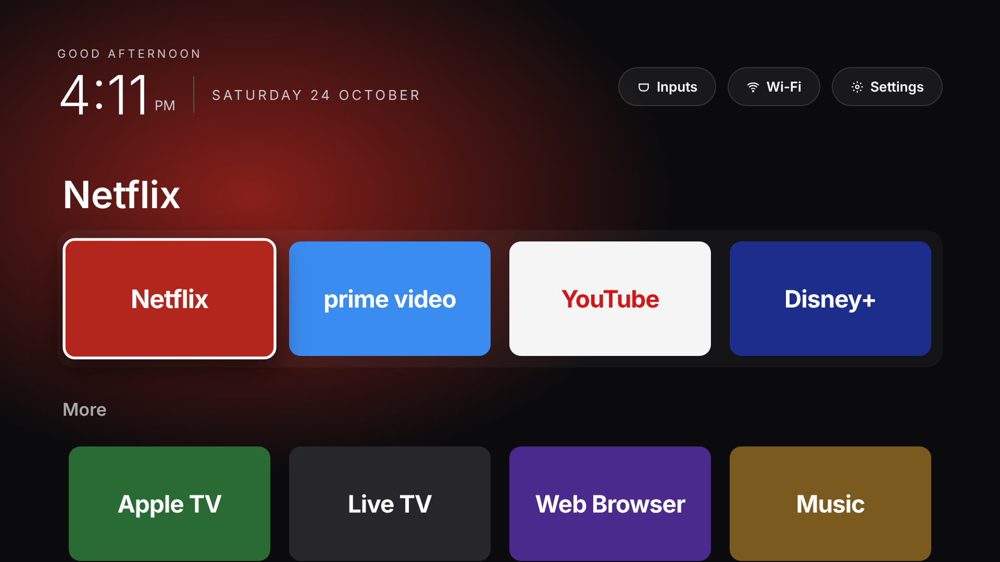

# LG TV Custom Home Screen

A clean, ad-free home screen for the LG 55UQ91006LC (webOS 22, firmware 04.60.90), styled after the reference design: greeting, big clock, date, quick buttons (Inputs, Wi-Fi, Settings) and large coloured app tiles with a background glow that follows the focused app.



## What is in this folder

| File | Purpose |
|---|---|
| `com.mohezz.homescreen_1.0.0_all.ipk` | Ready-to-install TV app |
| `app/config.js` | The only file you need to edit: tiles, colours, order, buttons |
| `app/main.js` | Clock, remote control navigation, app launching |
| `app/style.css` | Look and feel |

## Part 1: Remove the ads (no install needed, 10 minutes)

Do this first. It removes most of the ads on the stock LG home screen.

On the TV: **Settings (gear) > All Settings > General > System > Additional Settings > Home Settings**

| Setting | Set to |
|---|---|
| Home Promotion | Off |
| Content Recommendation | Off |
| Home Auto Launch | Off |

Then **Settings > All Settings > General > System > Additional Settings > Advertisement**: turn on **Limit AD Tracking**.

Then **Settings > All Settings > Support > Privacy & Terms > User Agreements**: untick **Viewing Information** and **Interest-Based Recommendations** (and **Voice Information** if you do not use voice). Leave the main Terms of Use accepted, otherwise the app store stops working.

Then **Settings > All Settings > General > System > Additional Settings**: turn off **Live Plus**.

Exact menu names can differ slightly by region.

### Optional: block ad servers on your network

If you run AdGuard Home, Pi-hole, or a router with DNS blocklists, block these domains:

```
ad.lgappstv.com
ngfts.lge.com
lgad.cjpowercast.com
us.ad.lgsmartad.com
eu.ad.lgsmartad.com
aic-ngfts.lge.com
info.lgsmartad.com
```

Do not block `lgtvsdp.com` or `lge.com` as a whole: that breaks the LG Content Store and app updates.

## Part 2: Install the custom home screen

You need a laptop (Windows, Mac, or Linux) on the same Wi-Fi as the TV.

### Step 1. Enable Developer Mode on the TV (free, official LG method)

1. Create a free account at https://webostv.developer.lge.com (top-right "Sign in").
2. On the TV, open **LG Content Store**, search for **Developer Mode**, install it.
3. Open the Developer Mode app, sign in with the account from step 1.
4. Turn **Dev Mode Status** ON. The TV restarts.
5. Open Developer Mode again, turn **Key Server** ON. Note the **IP address** shown.

The Developer Mode session has a time limit shown in the app. Open it and press **Extend** before it runs out, otherwise sideloaded apps are removed.

### Step 2. Install the LG command line tools on your laptop

Install Node.js (https://nodejs.org), then:

```bash
npm install -g @webos-tools/cli
```

### Step 3. Connect the laptop to the TV

```bash
ares-setup-device -a mytv -i "host=TV_IP_ADDRESS" -i "port=9922" -i "username=prisoner"
ares-novacom --device mytv --getkey
```

When asked for a passphrase, enter the 6-character code shown in the Developer Mode app on the TV (case sensitive).

### Step 4. Install and launch

From this folder:

```bash
ares-install --device mytv com.mohezz.homescreen_1.0.0_all.ipk
ares-launch  --device mytv com.mohezz.homescreen
```

"My Home" now appears in the TV's app bar.

### Step 5. Make it one click away

Press **Home** on the remote, long-press the **My Home** app, and move it to the first position in the app bar. From now on: Home, then OK.

## Using it

| Remote button | Action |
|---|---|
| Arrows | Move between tiles and buttons |
| OK | Open the app |
| Up from the first row | Jump to Inputs / Wi-Fi / Settings |
| Back | Return to the first tile |
| Magic Remote pointer | Point and click also works |

## Customising

Edit `app/config.js`: add, remove or reorder tiles and change colours. To find the exact ID of any app installed on your TV:

```bash
ares-launch --device mytv --list
```

App IDs that may need checking on your TV: Apple TV (`com.apple.appletv`) and Spotify (`spotify-beehive`). If an app is not installed, the screen shows a short message instead of opening it. Regional apps such as Shahid or OSN+ can be added the same way once you have their ID from the list command.

After editing, rebuild and reinstall:

```bash
ares-package app -o .
ares-install --device mytv com.mohezz.homescreen_1.0.0_all.ipk
```

You can also preview the design on a laptop by opening `app/index.html` in Chrome.

## Limits, stated honestly

| Topic | Reality |
|---|---|
| Replacing LG's own home screen | Not possible without rooting. Developer Mode gives you an app, not a system launcher. The LG Home button still opens LG's bar; this app is one OK press away. |
| Rooting | Depends on the exact firmware. Check https://cani.rootmy.tv with version 04.60.90. Rooting is unofficial, may void warranty, and can be closed by any firmware update. |
| Firmware updates | Keep them on for security. They do not remove this app, but they can close root exploits if you ever go that route. |
| Developer Mode expiry | Press Extend in the Developer Mode app before the timer ends, or reinstall with Step 4. |
| `requiredACG` packaging warning | Only matters for LG Content Store submission, not for sideloading. |
